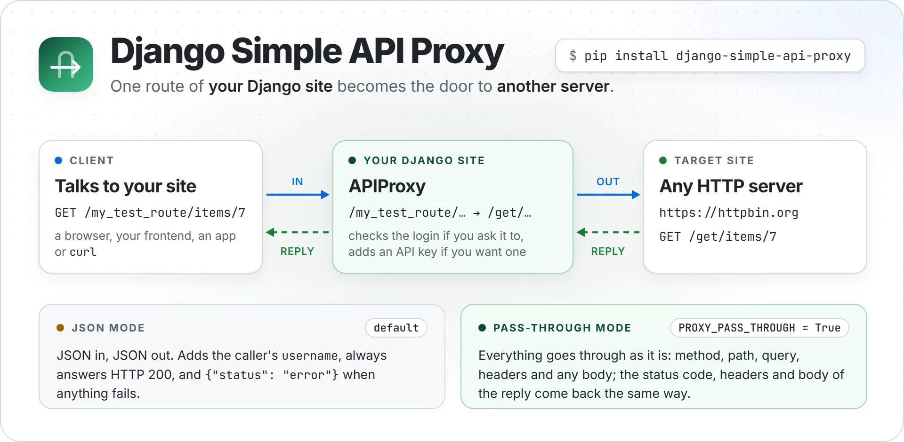

<p align="center">
  <picture>
    <source media="(prefers-color-scheme: dark)" srcset="https://raw.githubusercontent.com/NatLee/django-simple-api-proxy/main/docs/images/hero-dark.webp">
    
  </picture>
</p>

<p align="center">
  <a href="https://github.com/NatLee/django-simple-api-proxy/actions/workflows/test.yml"></a>
  <a href="https://pypi.org/project/django-simple-api-proxy/"></a>
  <a href="#supported-versions"></a>
  <a href="#supported-versions"></a>
  <a href="https://github.com/NatLee/django-simple-api-proxy/blob/main/LICENSE"></a>
</p>

Django Simple API Proxy turns one route of your Django site into a door to another server. A request that comes in at `/my_test_route/…` goes out to the server you point it at, and the answer comes back the same way, so your browser code, apps and users only ever talk to your site. Handy when the other server has no CORS headers, needs an API key you don't want in the browser, or should only be reachable for people logged in to your site. The proxy is a [Django REST framework](https://www.django-rest-framework.org/) view, so putting your login in front of it takes two lines.

It has two modes:

- **JSON mode** (the default, and all that 1.0 did): JSON in, JSON out. It adds the caller's `username` to what it sends and always answers HTTP 200.
- **Pass-through mode** (`PROXY_PASS_THROUGH = True`): everything goes through as it is. The method, path, query string, headers and body (JSON, forms, files, anything) go to the other server; its status code, headers, cookies and body come back to the client.

## Installation

```bash
pip install django-simple-api-proxy
```

This also installs Django REST framework, [requests](https://requests.readthedocs.io/) and [loguru](https://github.com/Delgan/loguru).

## Quick start

1. Add Django REST framework and the proxy to `INSTALLED_APPS` in `settings.py`:

   ```py
   INSTALLED_APPS = [
       ...,
       'rest_framework',
       'django_simple_api_proxy',
   ]
   ```

   Don't skip `rest_framework`: without it, the error pages Django REST framework shows to browsers (for example a 403 from a permission class) fail and turn into a 500.

2. Say where requests go, also in `settings.py`:

   ```py
   TARGET_API_URL = 'https://httpbin.org'
   PROXY_ROUTE_PATH = 'my_test_route'
   PROXY_TARGET_PATH = 'get'
   ```

   Now `/my_test_route/…` on your site maps to `https://httpbin.org/get/…`.

3. Send that route to the proxy in your project's `urls.py`:

   ```py
   from django.conf import settings
   from django.urls import include, path

   urlpatterns += [
       path(settings.PROXY_ROUTE_PATH, include('django_simple_api_proxy.urls')),
   ]
   ```

4. Start the server and send your first proxied request:

   ```bash
   python manage.py runserver
   curl "http://127.0.0.1:8000/my_test_route/?q=django"
   ```

   httpbin answers with what it received (formatted, and without `headers` and `origin`):

   ```json
   {
     "args": {"q": "django", "username": "#anonymous"},
     "method": "GET",
     "url": "https://httpbin.org/get?q=django&username=%23anonymous"
   }
   ```

   That's JSON mode: the query string went along, plus `username`. A path the other server doesn't know gets the proxy's error answer, with HTTP 200:

   ```bash
   curl "http://127.0.0.1:8000/my_test_route/nope"
   # {"status": "error"}
   ```

   and the server log says why: `Could not proxy GET /my_test_route/nope: the API server answered HTTP 404 (text/html), which is not JSON; set PROXY_PASS_THROUGH = True to pass any reply on.`

To try `POST`, `PUT`, `PATCH` and `DELETE`, set `PROXY_TARGET_PATH = 'anything'`; httpbin's `/anything` echoes every method:

```bash
curl -X POST http://127.0.0.1:8000/my_test_route/ \
     -H 'Content-Type: application/json' -d '{"user": "nat", "password": "hunter2"}'
# {..., "json": {"password": "hunter2", "user": "nat", "username": "#anonymous"}, "method": "POST", ...}
```

## Pass everything through

Turn on pass-through mode when the other server should see the request exactly as your client sent it, and the client should get the answer exactly as the server gave it. In `settings.py`:

```py
PROXY_PASS_THROUGH = True
PROXY_TARGET_PATH = ''  # the whole server, not only its /get
```

Status codes, reason phrases, content types and headers now come back as they are. Here httpbin's teapot, with its own `418 Unknown` (your site's `Date`, `Server` and security headers left out):

```bash
curl -i http://127.0.0.1:8000/my_test_route/status/418
```

```http
HTTP/1.1 418 Unknown
access-control-allow-credentials: true
access-control-allow-origin: *
access-control-expose-headers: Retry-After, RateLimit, RateLimit-Policy
x-content-type-options: nosniff
x-more-info: http://tools.ietf.org/html/rfc2324
Content-Length: 135


    -=[ teapot ]=-

       _...._
     .'  _ _ `.
    | ."` ^ `". _,
    \_;`"---"`|//
      |       ;/
      \_     _/
        `"""`
```

Any method, query string, header and body goes the other way. httpbin shows what it got (trimmed):

```bash
printf 'hello\n' > hello.txt
curl "http://127.0.0.1:8000/my_test_route/anything/items?a=1&a=2" -X PUT \
     -H "X-Hello: world" -F "note=hi" -F "file=@hello.txt"
```

```json
{
  "args": {"a": ["1", "2"]},
  "files": {"file": "hello\n"},
  "form": {"note": "hi"},
  "headers": {
    "Content-Type": "multipart/form-data; boundary=------------------------VfYdKtC57F043OvYAO8pbu",
    "X-Hello": "world",
    ...
  },
  "method": "PUT",
  "url": "https://httpbin.org/anything/items?a=1&a=2"
}
```

Binary replies and cookies come back too:

```bash
curl -s -o duck.png -w '%{http_code} %{content_type} %{size_download} bytes\n' \
     http://127.0.0.1:8000/my_test_route/image/png
# 200 image/png 8090 bytes

curl -i "http://127.0.0.1:8000/my_test_route/response-headers?X-Powered-By=httpbin&Set-Cookie=flavour%3Doatmeal"
# HTTP/1.1 200 OK
# content-type: application/json
# x-powered-by: httpbin
# Set-Cookie: flavour=oatmeal
# ...
```

And a path the other server doesn't know is its own 404 now, not `{"status": "error"}`.

## Settings

| Setting | Example | What it is |
|---|---|---|
| `TARGET_API_URL` | `'https://httpbin.org'` | The server requests go to, without a trailing slash. Required. |
| `PROXY_ROUTE_PATH` | `'my_test_route'` | The route on your site that is proxied. Required. |
| `PROXY_TARGET_PATH` | `'get'` | The path on that server the route maps to. Required; `''` works in pass-through mode. |
| `PROXY_PASS_THROUGH` | `True` | Pass everything through instead of JSON in, JSON out. Optional, `False` by default. |

The proxy reads them when Django loads your URLs. If `TARGET_API_URL` or `PROXY_TARGET_PATH` is missing, `manage.py check` and `runserver` stop and tell you what to add (a missing `PROXY_ROUTE_PATH` already stops them at the line of your `urls.py` that uses it):

```
django.core.exceptions.ImproperlyConfigured: django-simple-api-proxy needs TARGET_API_URL in your settings. Add to settings.py, for example:
    TARGET_API_URL = 'https://httpbin.org'  # the server requests are sent on to
```

In JSON mode, write the paths without slashes at either end and don't leave `PROXY_TARGET_PATH` empty, or the proxy builds wrong URLs (see [Known limitations](#known-limitations)). `manage.py check` and `runserver` warn about that, without stopping:

```
System check identified some issues:

WARNINGS:
?: (django_simple_api_proxy.W003) PROXY_ROUTE_PATH starts or ends with '/', so the proxy builds wrong URLs: with 'my_test_route/', /my_test_route/abc goes to /getabc.
	HINT: Write it without slashes: PROXY_ROUTE_PATH = 'my_test_route'.

System check identified 1 issue (0 silenced).
```

Pass-through mode trims those slashes itself. To silence a warning, add its id to `SILENCED_SYSTEM_CHECKS`.

With the quick start settings, paths map like this:

| Request to your site | JSON mode sends | Pass-through mode sends |
|---|---|---|
| `/my_test_route` or `/my_test_route/` | `https://httpbin.org/get` | `…/get` or `…/get/` |
| `GET /my_test_route/items/42/?a=1` | `https://httpbin.org/get/items/42?a=1&username=%23anonymous` | `https://httpbin.org/get/items/42/?a=1` |

## Customising

Subclass `APIProxy`. This one only lets logged-in users through and also sends their e-mail address:

```py
from rest_framework.authentication import SessionAuthentication
from rest_framework.permissions import IsAuthenticated
from rest_framework_simplejwt.authentication import JWTAuthentication

from django_simple_api_proxy.views import APIProxy


class MyAPIProxy(APIProxy):
    # Anyone not logged in gets a 403, and nothing is forwarded.
    authentication_classes = [SessionAuthentication, JWTAuthentication]
    permission_classes = [IsAuthenticated]

    def update_payload(self, request, params):
        params = super().update_payload(request, params)  # adds "username"
        params["email"] = request.user.email
        return params
```

`JWTAuthentication` comes from a separate package: `pip install djangorestframework-simplejwt`. With `SessionAuthentication`, Django REST framework also checks the CSRF token on `POST`, `PUT`, `PATCH` and `DELETE` from logged-in browsers.

Then route `PROXY_ROUTE_PATH` to your class in `urls.py`, instead of including `django_simple_api_proxy.urls`:

```py
from django.conf import settings
from django.urls import path

from .views import MyAPIProxy  # wherever you defined it

urlpatterns += [
    path(settings.PROXY_ROUTE_PATH, MyAPIProxy.as_view(), {"resource": ""}),
    path(settings.PROXY_ROUTE_PATH + "<path:resource>", MyAPIProxy.as_view()),
]
```

A subclass can also be a pass-through proxy of its own, next to the one from your settings. This one adds an API key on the server, so the key never reaches the browser, and keeps your site's cookies on your site:

```py
from django.conf import settings

from django_simple_api_proxy.views import APIProxy


class KeyedProxy(APIProxy):
    pass_through = True
    target_api_url = "https://httpbin.org"  # your API server
    proxy_route_path = "keyed"
    proxy_target_path = ""

    def upstream_headers(self, request):
        headers = super().upstream_headers(request)
        headers.pop("Cookie", None)
        headers["Authorization"] = f"Bearer {settings.UPSTREAM_API_KEY}"
        return headers
```

Route it like `MyAPIProxy` above, with `"keyed"` in place of `settings.PROXY_ROUTE_PATH`. httpbin's `/headers` shows what arrived:

```bash
curl -H "Cookie: sessionid=abc" -H "X-Hello: world" http://127.0.0.1:8000/keyed/headers
# {"headers": {"Authorization": "Bearer demo-key", "X-Hello": "world", ...}}   no Cookie
```

What else a subclass can change:

| Override | By default | Override it to |
|---|---|---|
| `authentication_classes`, `permission_classes` | `[]`: no login, anyone can use the proxy | require a login, as above |
| `target_api_url`, `proxy_route_path`, `proxy_target_path` | the three settings | proxy a second server from another subclass |
| `pass_through` | `PROXY_PASS_THROUGH` | switch the mode for one subclass |
| `update_payload(request, params)` | sets `username` (JSON mode) | add or drop what is sent |
| `upstream_headers(request)` | the client's headers (pass-through mode) | add an API key, drop cookies |
| `send_request(method, url, params=None, data=None, json=None, timeout=180, verify=True, headers=None)` | calls `requests.request` | change the timeout, reuse a session |
| `response(resp)` | returns the JSON as is, non-ASCII text unescaped (JSON mode) | reshape the reply |
| `relay_response(upstream)` | copies status, headers, cookies and body (pass-through mode) | change the reply |
| `get`, `post`, `put`, `patch`, `delete`, `head`, `options` | forward the request | replace one method completely |

If you override `send_request` and use pass-through mode, accept `headers` (or `**kwargs`): pass-through mode sends the client's headers through it.

## How requests are forwarded

| | JSON mode (default) | Pass-through mode |
|---|---|---|
| Methods | `GET`, `POST`, `PUT`, `PATCH`, `DELETE`. `HEAD` goes as `GET`; Django REST framework answers `OPTIONS` | `GET`, `POST`, `PUT`, `PATCH`, `DELETE`, `HEAD`, `OPTIONS`, each as itself |
| Path | the route swapped for `PROXY_TARGET_PATH`, trailing slash dropped | the route swapped, the rest kept exactly, trailing slash too |
| Query string | `GET` only, plus `username` | every method, exactly as sent |
| Request headers | none: requests' defaults | the client's, see below |
| Request body | a JSON object, plus `username` | any body, byte for byte |
| Reply status | always 200 | the other server's |
| Reply headers | none from the other server: `Content-Type: application/json` | the other server's, see below |
| Reply body | the JSON, encoded again | byte for byte, decompressed |
| On failure | 200 with `{"status": "error"}` | 502 (can't reach it) or 504 (no answer in time) with `{"status": "error"}` |

Both modes:

- **Login**: the proxy is a Django REST framework view, so `authentication_classes` and `permission_classes` work in both modes, and a refused request is never forwarded.
- **TLS and timeout**: the other server's certificate is checked, and it has 180 seconds to answer. Override `send_request` to change either.
- **Redirects** are followed on your server, so the client gets the final answer.
- **Other methods** (`TRACE`, …) get `405 Method Not Allowed` and are not forwarded.
- **Logs**: each request is logged at `DEBUG` level, failures at `ERROR` level with the reason and the traceback. The proxy's own log lines never hold bodies or header values. See [Logging](#logging).

JSON mode:

- **`username`**: the user Django REST framework authenticated, or `#anonymous`. The stock `APIProxy` has no authentication classes, so it sends `#anonymous` even for users logged in to your site; [subclass it](#customising) to send real names. A `username` sent by the client is replaced. User models without a `username` field send what `get_username()` returns.
- **Errors**: if the body is not a JSON object, the other server can't be reached or doesn't answer in time, or its reply is not JSON, the client gets `{"status": "error"}` with HTTP 200, and the log says which it was.

Pass-through mode:

- **Request headers**: all the client sends, cookies and `Authorization` included, except the ones that only describe one connection (`Connection` and the headers it names, `Keep-Alive`, `Proxy-Authorization`, `TE`, `Trailer`, `Transfer-Encoding`, `Upgrade`) and the ones requests sets itself (`Host`, `Content-Length`, `Accept-Encoding`, `Expect`). The proxy adds nothing of its own (no `username`, no `X-Forwarded-For`); requests only fills in `User-Agent` and `Accept` when the client sent none.
- **Reply headers**: all the other server sends, every `Set-Cookie` included, except the per-connection ones, `Content-Encoding` and `Content-Length` (requests has already decompressed the body), and `Date` and `Server` (your web server sets its own).
- **Your site's cookies go along.** If your site's own login uses cookies or `Authorization`, and the other server is not yours, drop them in `upstream_headers()` as `KeyedProxy` does above.
- **Bodies are read into memory**, in both directions. Django refuses request bodies over [`DATA_UPLOAD_MAX_MEMORY_SIZE`](https://docs.djangoproject.com/en/stable/ref/settings/#data-upload-max-memory-size) (2.5 MB by default) with a 400; raise it for bigger uploads. Streams (server-sent events, WebSockets) don't go through.
- **Nothing in the reply is rewritten**: links in HTML and `Location` headers still point at the other server, and a cookie set by a redirect the proxy followed is lost.

### Known limitations

In JSON mode, the proxy behaves like this, and keeps doing so for compatibility. Pass-through mode has none of these.

1. Errors and the other server's own status codes (404, 201, …) all reach the client as HTTP 200.
2. A `PROXY_ROUTE_PATH` with a trailing slash, or an empty `PROXY_TARGET_PATH`, builds wrong URLs: with `'my_test_route/'`, `/my_test_route/abc` goes to `/getabc`. `PROXY_ROUTE_PATH` is also used as a regular expression, and `/my_test_routeabc` reaches the proxy too.
3. `POST`, `PUT`, `PATCH` and `DELETE` drop the query string, and form-encoded bodies get `{"status": "error"}`.

## Logging

The proxy logs through loguru: every request at `DEBUG` level, failures at `ERROR` level with the reason and the traceback. Request bodies are logged by field name or size only, never by value, and headers by name only. The `POST` from the quick start logs this in JSON mode:

```log
2026-11-03 14:41:12.254 | DEBUG    | django_simple_api_proxy.views:_forward:275 - Proxy POST /my_test_route/
2026-11-03 14:41:12.254 | DEBUG    | django_simple_api_proxy.views:preprocess_request_body:189 - JSON body fields: ['user', 'password']
2026-11-03 14:41:12.254 | DEBUG    | django_simple_api_proxy.views:get_proxy_path:155 - Upstream URL: https://httpbin.org/anything
2026-11-03 14:41:12.254 | DEBUG    | django_simple_api_proxy.views:update_payload:172 - Username: #anonymous
```

and the `PUT` from [Pass everything through](#pass-everything-through) this:

```log
2026-11-03 14:41:16.802 | DEBUG    | django_simple_api_proxy.views:_forward:275 - Proxy PUT /my_test_route/anything/items
2026-11-03 14:41:16.802 | DEBUG    | django_simple_api_proxy.views:get_proxy_path:155 - Upstream URL: https://httpbin.org/anything/items
2026-11-03 14:41:16.802 | DEBUG    | django_simple_api_proxy.views:_pass_through:318 - Forwarding headers ['Accept', 'Content-Type', 'User-Agent', 'X-Hello'] and 306 bytes of body
2026-11-03 14:41:17.394 | DEBUG    | django_simple_api_proxy.views:_pass_through:326 - API server answered 200 (application/json, 557 bytes)
```

Unless you configure it, loguru prints all of this to stderr. Its default handler also prints the values of local variables in tracebacks (`diagnose=True`), so when a request fails, its body can still show up in the traceback. If bodies may hold passwords or tokens, turn the proxy's log off, or keep only `INFO` and up without the variable values:

```py
import sys

from loguru import logger

logger.disable("django_simple_api_proxy")  # no log from the proxy at all

# or
logger.remove()
logger.add(sys.stderr, level="INFO", diagnose=False)
```

## Supported versions

| | Versions |
|---|---|
| Python | 3.8 – 3.14 |
| Django | 4.0 – 6.1 |
| Django REST framework | the release pip picks for your Django |

CI tests every Django release from 4.0 to 6.1, each on the oldest and the newest Python it supports: 17 combinations. The package ships type hints (`py.typed`).

## Development

```bash
git clone https://github.com/NatLee/django-simple-api-proxy.git
cd django-simple-api-proxy
pip install -e ".[test]"
pytest tests
```

The tests don't need the internet. JSON mode is tested against a fake `requests.request`; pass-through mode against a real HTTP server the tests start on `127.0.0.1` (`tests/upstream.py`). `tests/test_readme.py` runs the Python blocks of this README, so keep them working when you edit it.

To run the CI combinations locally:

```bash
pip install tox
tox -e py               # the Python on PATH with the newest Django it can install
tox -e py312-django42   # one combination; `tox -l` lists them all
```

There is also a small Django project to try things in: [`example/api_proxy_example`](https://github.com/NatLee/django-simple-api-proxy/tree/main/example/api_proxy_example).

```bash
pip install -e .
cd example/api_proxy_example
python manage.py runserver
```

The picture at the top is drawn in [`docs/images/src/hero.html`](https://github.com/NatLee/django-simple-api-proxy/blob/main/docs/images/src/hero.html); the commands to render it are in the file.

## License

[MIT](https://github.com/NatLee/django-simple-api-proxy/blob/main/LICENSE)
